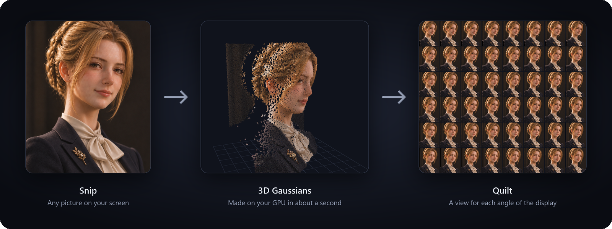

# HoloSnip for Looking Glass

Press `Ctrl+Alt+S` and drag around anything on your screen. About a second later, it is on your Looking Glass in 3D.

Free for non-commercial use. Unofficial, not affiliated with Looking Glass Factory.

## Requirements

- Windows 10 / 11 (x64) and a DirectX 12 GPU with about 8GB of VRAM
- Looking Glass Portrait or Go (Go in Desktop Mode), with [Looking Glass Bridge](https://lookingglassfactory.com/software/looking-glass-bridge) running

## Install

Download the zip from [Releases](https://github.com/solidpearls-code/HoloSnip-for-Looking-Glass/releases), extract it to a folder you can write to, such as `Documents\HoloSnip`, and run `HoloSnip.exe`. If Windows warns you, choose **More info → Run anyway**.

To uninstall, turn off Settings → Start with Windows, quit, and delete the folder.

## Use

Press `Ctrl+Alt+S` or click the tray icon, then drag. Esc cancels. `HoloSnip.exe image.jpg` shows an image file.

Everything runs on your PC, and the app never goes online. Nothing you select is saved unless you choose Save Hologram. Text and flat screenshots break up at the side views.

The tray menu has:

- **Save Hologram...**: saves a quilt PNG to load in the official software. Keep the end of the file name, such as `_qs8x6a0.75`.
- **Motion**: the subject breathes, sways slightly and blinks. The GPU stays busy while it is on.
- **Depth**, **View Angle**
- **Settings**: remove borders or the background, lock the selection to the display's aspect, change the hotkey, start with Windows

## License

See [LICENSE.txt](LICENSE.txt). The models (3D by [UniSHARP](https://github.com/Insta360-Research-Team/UniSHARP)) and libraries in the zip keep their own licenses, listed in the `licenses` folder. UniSHARP limits use to non-commercial purposes, and the Sapiens2 License lists uses it does not allow. Looking Glass is a trademark of Looking Glass Factory.
