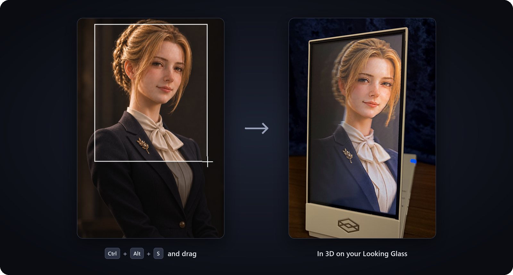

# HoloSnip for Looking Glass

- Press `Ctrl+Alt+S` and drag around any picture on your screen.
- About a second later, it's on your Looking Glass in 3D.
- Works on anything you can see: web pages, artwork, even a paused video.
- Private: it never goes online and doesn't keep what you snip.
- Turn on Motion in the tray and people breathe and blink.

## Get started

1. [Download the zip](https://github.com/solidpearls-code/HoloSnip-for-Looking-Glass/releases/latest) (1.5GB, models included) and unzip it to a folder you can write to, such as `Documents\HoloSnip`.
2. Open [Looking Glass Bridge](https://lookingglassfactory.com/software/looking-glass-bridge) and run `HoloSnip.exe`. If Windows warns you, choose **More info → Run anyway**.
3. Press `Ctrl+Alt+S` or click the tray icon, then drag. Esc cancels.

Needs Windows 10 / 11 and a DirectX 12 GPU with about 8GB of VRAM. Works on Portrait and Go (Go in Desktop Mode).

## Tray menu

- **Save Hologram...**: saves a quilt PNG to load in the official software. Keep the end of the file name, such as `_qs8x6a0.75`.
- **Motion**: the subject breathes, sways slightly and blinks. The GPU stays busy while it is on.
- **Depth**, **View Angle**
- **Settings**: remove borders or the background, lock the selection to the display's aspect, change the hotkey, start with Windows

To uninstall, turn off Settings → Start with Windows, quit, and delete the folder.

## License

Free for non-commercial use; see [LICENSE.txt](LICENSE.txt). The models and libraries in the zip keep their own licenses, listed in the `licenses` folder. UniSHARP limits use to non-commercial purposes, and the Sapiens2 License lists uses it does not allow. Unofficial, not affiliated with Looking Glass Factory. Looking Glass is a trademark of Looking Glass Factory.
